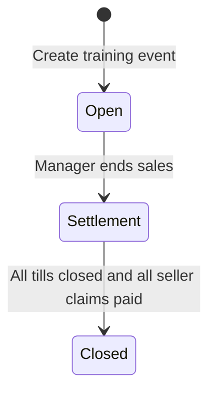
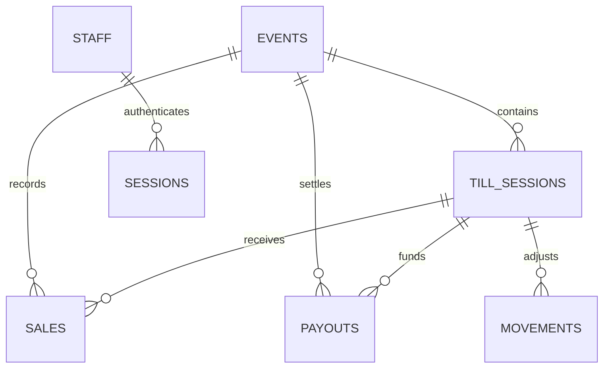

# Domain and data model

## Financial rules

All persisted amounts are integer euro cents. Commission is integer basis points:
`1500 = 15%`. For each seller, sum items from non-voided sales, then calculate:

```text
commission = floor((sellerGross * rate + 5000) / 10000)
sellerNet  = sellerGross - commission
salePayable = goodsTotal + donation
change = received - salePayable
expectedTill = opening + activeSalePayables + signedMovements - sellerPayouts
```

Do not sum the `received` field as revenue: change has been handed back.
Donations belong to the association; they do not increase seller gross or
commission. A full void reverses goods and donation in the original till.
A void is rejected if that till is closed, cash is insufficient, or an affected
seller has already been paid. Partial refunds are not implemented.

A payout snapshots gross, commission and net. One payout per seller/event is
protected by a unique database index. Deposits and withdrawals need a reason;
a withdrawal cannot make the computed till balance negative. Count differences
at closure need a note. The software cannot verify physical cash or prevent a
cashier from entering the same physical article again under a new item ID.

## Event lifecycle



Sales require `open`; payouts require `settlement`. Reopening a closed event is
not supported. Settings (commission, seller range, till count) lock after the
first till opens. A till session is a cash container; an authenticated staff
account is a separate identity. A till number may have successive sessions,
but the application prevents two simultaneously open sessions for that number.
The schema does not yet enforce that latter invariant independently.

## Authorization matrix

| Action | Cashier | Manager |
| --- | --- | --- |
| Read full authenticated event snapshot | Yes, currently | Yes |
| Open a till and record sales | Yes | Yes |
| Void, deposit/withdraw, payout, close till | No | Yes |
| Change/create event, end sales, close event | No | Yes |
| Add staff | No | Yes |

Any authenticated cashier can currently book against any open till in the
selected event; there is no exclusive device/staff assignment enforced on the
server. Decide whether that matches event operations. Read permissions need a
separate review; manager-only UI tabs do not restrict the GET snapshot.

## Persisted entities



| Table | Role / key constraint |
| --- | --- |
| `events` | Configuration, lifecycle, optimistic `version` and `last_op` |
| `till_sessions` | Opening float, closure count, expected amount and note |
| `sales` | Immutable initial receipt/items JSON plus void metadata; event-wide number |
| `payouts` | Seller settlement; unique `(event_id, seller)` |
| `movements` | Signed cash movement and reason |
| `staff`, `sessions`, `login_limits` | PIN hash/role, expiring session, account attempt counter |
| `audit` | Human-readable activity history, not a tamper-proof ledger |
| `operations` | Unique operation ID, scope/fingerprint, committed or rejected outcome and stored result |
| `__basar_migrations` | Self-hosted applied-migration filenames |

Sales store stable staff ID and display name. Several other records store only
a staff name; stable actor attribution is incomplete. Event/staff/action links
in audit/operation records are not all foreign keys. Commission/net/balance
rules are largely service-level checks, not database CHECK constraints.

## Integrity work still required

Add reviewed constraints for event receipt numbers and open till numbers; add
indexes for event-scoped reads and joins. Validate existing rows before applying
uniqueness constraints. Consider safe-integer bounds on aggregate totals, explicit
status/role enums and stable actor IDs for every financial action. Preserve
history and operation records when introducing retention or archival jobs.
