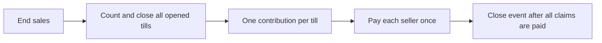

# Domain and data model

## Prices and financial rules

Persist amounts as integer euro cents and commission in basis points (`1500 = 15%`).
New articles must cost positive multiples of 50 cents, at most EUR 10,000. Article
input uses tenths of euros: `5` = EUR 0.50, `25` = EUR 2.50. Received cash, counts,
floats and movements retain normal euro input. Validation also runs on the server.

For each seller, sum active items before calculating:

```text
commission = floor((sellerGross * rate + 5000) / 10000)
unroundedNet = sellerGross - commission
roundingDonation = unroundedNet % 10        # new pooled events
sellerNet = unroundedNet - roundingDonation
salePayable = goodsTotal + checkoutDonation
change = received - salePayable
expectedTill = opening + activeSalePayables + signedTillMovements
```

Payout rounding is separate from commission and checkout donations. Payouts
snapshot all components with `gross = commission + rounding + net`. Received cash
is not revenue: change is returned. A full void reverses goods and checkout tips
in the original open till. It is refused after closure or a seller payout.

## Counted cash and pooled settlement

New events have `settlement_mode = 'pool'`:

1. End sales; no new sales or till openings can commit.
2. Count/close every opened till. Explain count differences. Closure and its one
   **entire counted amount** pool contribution commit atomically.
3. Pay sellers from the event pool after all opened tills close. Payouts and pool
   movements serialize through the event revision and cannot overdraw cash.

```text
poolCash = countedTillContributions + signedPoolMovements - pooledPayouts
```

Floats are included in counted contents. Return them through an audited pool
withdrawal; never subtract them twice or classify them as sales. Actual counts
may differ from expected amounts, so the pool uses counted cash. Final association
cash reflects commission, checkout tips, payout rounding, movements and differences.



Existing events keep `settlement_mode = 'till'`: their cent-exact claims and
till-funded payouts remain unchanged. New events always use pool policy. Never
relabel historical events or recalculate already recorded financial outcomes.

## Authentication and authorization

A cashier is assigned one event and till **number**. A person is an identity; a
till is a cash container. An event manager can manage its own event/team. The
unbound central setup manager can create events. Public demo accounts remain
protected evaluation fixtures.

| Capability | Cashier | Event manager | Central setup manager |
| --- | --- | --- | --- |
| Event selection | Assigned | Assigned | All |
| Till / checkout | Assigned number | Event tills | Selected event |
| History, totals, full export | Assigned till | Own event | Selected event |
| Seller claims, pool, audit | No | Own event | Selected event |
| Team/PIN management | No | Own event | Selected event; can assign legacy unassigned cashiers |
| Create another event | No | No | Yes |

Read filters run in SQL for receipts, searches, exports and totals. Commands and
operation lookup enforce event/till scope too. Recoverable PINs appear only in an
explicit manager team response, never normal snapshots. See the
[PIN key and operator workflow](../operations/event-teams-and-settlement.md).

Team edits preserve IDs, increment `auth_version`, revoke sessions and record
an audit/outcome atomically. Financial commit and login session-issuance guards
reject work prepared under an old authorization, including concurrent PIN resets.
Resolve open tablet work before changing scope or disabling a person.

## Entities and invariants

| Entity | Responsibility / constraint |
| --- | --- |
| `events` | Lifecycle, settlement policy, revision and last operation |
| `staff` | Identity, login hash/encrypted display PIN, scope and authorization version |
| `sessions`, `login_limits` | Expiring session and account attempt counter |
| `till_sessions` | Float/count/expectation; unique open event/number |
| `sales` | Receipt/items plus void metadata; unique event receipt number |
| `pool_entries` | Counted contribution or signed movement; one contribution per till |
| `payouts` | Unique event/seller; pool funding has no till; accounting/funding checks |
| `movements` | Signed change to an open till |
| `audit`, `operations` | Atomic activity and immutable operation outcome |
| `instance_state` | Restore epoch and write pause |
| `__basar_migrations` | Applied self-hosted SQL filenames |

Historical names/financial records survive team edits. Some legacy audit/movement
rows lack stable actor IDs; new pool entries include ID and name. The database
cannot verify cash physically, identify repeated physical articles without an
article ID, or replace operator reconciliation.
