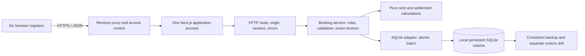

# Architecture overview

Status: description of the evaluation implementation, with proposed improvements
explicitly identified. Read [production readiness](../production-readiness.md)
before treating any component as approved for live cash handling.

## System boundary

This is the self-hosted topology. An alternative deployment replaces Next.js
self-hosting and the local adapter with Vinext/Cloudflare Worker and a D1 binding.
These are separate runtime profiles sharing domain/service code; they are not
replicas of one deployment and do not synchronize their databases.

Keep the self-hosted service to one application process and one local persistent
volume for now. Do not assume multiple containers, a network filesystem or a
second server will work as a supported high-availability arrangement.

## Responsibilities and dependencies

| Layer | Files | Responsibility |
| --- | --- | --- |
| Browser | `app/page.tsx`, `app/globals.css` | Basket entry, draft/pending state, dialogs, reports, 12-second polling |
| HTTP | `app/api/basar/route.ts`, `lib/basar/http.ts` | Origin, session cookie, JSON validation, GET/POST responses |
| Service | `lib/basar/service.ts` | Bootstrap, authentication, authorization, reads, commands, optimistic transaction protocol |
| Domain | `lib/basar/domain.ts` | Cent arithmetic, seller commission, till balance, item validation |
| Schema | `db/schema.ts`, `drizzle/*.sql` | Drizzle definitions and applied SQL migrations |
| Self-host runtime | `selfhost/*.mjs` | `node:sqlite`, migration startup, HTTP server, consistent backup |
| Hosted runtime | `worker/index.ts`, `vite.config.ts`, `.openai/hosting.json` | Vinext worker, D1 binding and inherited hosting integration |

The service currently depends on the D1-shaped `prepare/bind/first/all/run/batch`
API via mutable `globalThis.__basarDB`. The SQLite adapter implements that subset.
There is no explicit injected repository interface yet. The UI and service are
large modules with loosely typed command payloads; the architecture is not yet
modular enough for independent teams to change financial workflows casually.

## Data flow

A browser persists its draft and command ID locally, sends a command to the
single API route, receives a result, then requests a refreshed event snapshot.
A successful booking response follows database commit. GET returns `no-store`.
The UI also refreshes every 12 seconds; this is not push synchronization.

Every authenticated snapshot currently loads **all event sales and item JSON**,
tills, payouts, movements and the last 200 audit rows. The service does the same
before each event mutation. As the bazaar grows, both booking work and network
traffic grow. The local load test deliberately includes end-of-day history.

## Failure boundaries

A browser draft is not a committed sale. A lost reply can leave an unknown
outcome until the same operation is replayed. A healthy process is not evidence
that a database can accept a transaction or that the Wi-Fi works. A SQLite file
on the server is not an off-server backup. See the
[transaction protocol](transactions.md) and [event-day runbook](../operations/event-day.md).

The portal evaluation shares a host and reverse proxy with another application,
but has its own container and database volume. Availability still depends on
that host, its disk, network, proxy and power; the demo is not a failover design.

## Intended refactoring direction

1. Explicit typed command/result contracts, bounded read APIs and database queries
   for affected financial aggregates instead of full-event snapshots.
2. Separate authentication, query and command modules; keep pure money rules
   independently testable. Split the UI by workflow and centralize recovery state.
3. Inject a small database/repository contract and verify both adapters against it.
4. Add constraints and indexes through reviewed migrations after checking old data.

Preserve financial behavior with invariants and failure tests before restructuring.
A switch to a different database is a decision to benchmark and operate, not an
automatic prerequisite for six registers.
