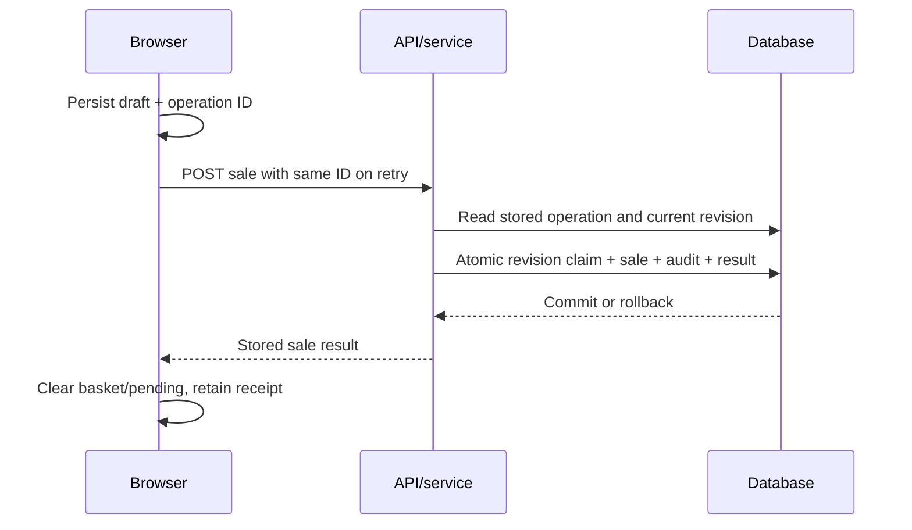

# Transactions, concurrency and recovery

## Booking protocol implemented today

1. Validate the operation ID; return a stored result if its staff/action/event
   scope matches an existing operation.
2. Read event revision and financial state; check roles, phase, till and balances.
3. Build one atomic batch: conditional event revision update, financial statements,
   audit entry and stored operation result.
4. Claim the event revision with `UPDATE ... WHERE version = observedVersion`.
   Financial/audit/operation statements are guarded by `events.last_op = operationId`.
5. Commit all statements or roll them all back. If the claim failed, read fresh
   state and retry. The current limit is **five internal attempts**, then HTTP 409.
6. Return the stored financial result only after successful commit. A repeated
   operation returns the original sale ID/number/change instead of a new sale.

`createEvent` and `addStaff` use separate atomic batches outside this event CAS
loop. Their concurrent-replay/error handling is not yet uniform with sales.

The final browser transition above spans multiple current localStorage/React
updates; it is **not atomic**. That gap requires fault testing and redesign.

## Storage contracts

The self-hosted adapter uses `DatabaseSync`, WAL, foreign keys and a 5-second busy
timeout. `batch()` executes `BEGIN IMMEDIATE`, all statements, then `COMMIT`, with
`ROLLBACK` on error. SQLite permits one writer at a time; WAL does not create six
parallel writers. A single application process serializes synchronous SQL work,
which can also delay HTTP responses as history grows.
[SQLite transactions](https://sqlite.org/lang_transaction.html) and
[WAL documentation](https://sqlite.org/wal.html) describe these constraints.

The hosted service relies on D1 `batch()` transaction semantics. A failed statement
rolls back the batch. This contract is documented by
[Cloudflare](https://developers.cloudflare.com/d1/worker-api/d1-database/#batch).
Local SQLite tests do not certify remote D1 latency, limits or behavior. Run the
same adapter/HTTP acceptance scenarios against whichever backend is selected.

The adapter does not explicitly set `synchronous`; record the effective SQLite
version and durability PRAGMAs in the deployment acceptance test. Container restart
tests are not evidence for power-loss durability or a reliable storage device.

## Evidence and current limits

Six synchronized service calls reproducibly cause a 409 for one call in each
six-call burst in the recorded test: five retries are insufficient for that
schedule. The rejected call leaves no partial financial booking. Explicit retry
with the same ID completes it; 60 distinct commands produced exactly 60 sales.
This is a **known contention limit**, not a passed production acceptance gate.
An HTTP workload has different scheduling; its results are recorded separately.

An operation ID protects retries of one command. It does not deduplicate a basket
submitted under a new ID. The current result lookup also does not compare a
canonical payload hash: reusing the same ID for different sale contents returns
the earlier result. Scope checks are inconsistent in inner retry/catch branches;
standardize them for all actions and reject conflicting reuse.

## Failure cases to resolve before real cash

| Failure | Current behavior / remaining risk | Required acceptance |
| --- | --- | --- |
| Reply lost after commit | Same ID can retrieve result; new ID could duplicate the basket | Browser recovers the original receipt and clears the draft exactly once |
| Browser closes after reply | Pending key is removed before cleared draft/receipt is durably saved | One durable recovery record/state machine, tested at every transition |
| Temporary DB failure | Non-ApiError POST failures currently become 400; client clears pending for all responses below 500 | Classify retryable/unknown outcomes, preserve ID, provide status lookup |
| Six-way CAS contention | Five attempts may exhaust; browser clears pending on 409 | Bounded retry/backoff with preserved ID and explicit user outcome |
| Device offline | Draft retained, no supported offline booking | No success display without server commit; safe reconnect/replay |
| Crash during batch | SQLite rollback/commit contract protects one transaction | Process termination around commit with independent ledger verification |
| Double payout / phase change / closure race | CAS and payout unique index protect tested cases | Test mixed sale/end-sales/void/withdraw/payout/close schedules |
| Backup restored while devices retain pending work | Restored DB may lack already acknowledged operations | Document cutover fence and reconcile devices before resuming |

Persist only non-secret command data; `addStaff` currently puts the PIN into the
same pending-command storage as financial commands. An API for operation status,
payload fingerprint and stable error codes should be part of the recovery contract.
Do not silently retry arbitrary new IDs or interpret a timeout as a failed sale.
