# Transactions, concurrency and recovery

Status: evaluation implementation. The recovery change implements the software
controls below; actual tablet/venue acceptance and the other
[production gates](../production-readiness.md) remain required.

## Server booking protocol

1. Enforce the instance epoch/write pause, current authorization and event/till scope, then validate the operation ID. Look up its stored outcome and verify staff, event,
   action and request fingerprint before returning it.
2. Read the event revision and command-specific rows/aggregates; validate the command.
3. Build one atomic batch claiming the observed revision and matching active staff authorization version. Successful commands
   store their financial effect, audit entry and `committed` operation result.
4. Business rejections are also stored against the operation ID, guarded by the
   same event revision, as a `rejected` outcome with no financial/audit effect.
5. All statements are guarded by `events.last_op = operationId`; the operation
   primary key prevents two outcomes for one ID. A failed batch rolls back.
6. On contention, read fresh state and retry up to twelve internal attempts
   with bounded randomized delay.
   Exhaustion returns `409 / CONCURRENT_WRITE`, not a recorded rejection.

Pooled closure updates the till and its unique counted contribution together. Pool
payouts/withdrawals use the same event revision and cannot overdraw cash. Team edits
revoke sessions atomically; stale financial work cannot commit with old authorization.

A stored rejection cannot later become a sale, even when another copy of the
request is in flight. The rejection participates in the revision/operation
protocol; it is not inferred from an arbitrary HTTP 400. If another copy committed
first, replay returns its stored result instead. This prevents a client from
clearing a rejected draft while an earlier copy later books the same intent.

`createEvent` uses its own atomic creation batch and unique operation record;
validation failures also have durable rejected outcomes. `addStaff` and `updateStaff`
are non-financial, non-durable browser workflows: PINs are never put in pending storage
or a fast request hash. It retains scope-checked operation replay but has no full
payload fingerprint. Their changes/session revocation/audit/outcome still use the
event revision and atomic batch. Display PINs are encrypted. Recovery guarantees here primarily concern financial commands.

## Outcome API and identity

POST `{action: "operationStatus", command: originalCommand}` to `/api/basar`.
The endpoint requires the same authenticated staff member, expected Origin and
JSON. It returns `committed` plus the original result, `rejected` plus the stored
error, or `not_found`. A mismatch of actor/event/action/payload returns 409 and
must be resolved by the operator; it is not permission to create a new ID.

`request_hash` is a SHA-256 fingerprint of the relevant non-secret business
fields, with stable object-key ordering and the original item order. Reusing an
ID for different financial contents is rejected. Migration `0002` preserves old
operation rows as committed with a null hash. Legacy sale replay is verified
against its original persisted sale, including items, till, donation and cash
received. Other legacy actions retain scope checks without a payload fingerprint.

`not_found` does not prove an earlier request cannot still commit. The browser
resubmits the **same immutable command and ID**; database serialization and the
unique outcome handle races safely. Do not delete operation records while clients
can still hold pending requests.

## Browser state and wake-up

`lib/basar/register.ts` defines one versioned record per origin, base path and
browser profile. It holds the selected event/till, basket, partially entered
fields, pending command and last receipt. Every relevant transition replaces one
localStorage value synchronously before updating React state:

```mermaid
stateDiagram-v2
  [*] --> Draft
  Draft --> Pending: Persist original command before transmission
  Pending --> Pending: Timeout / offline / 401 / unrecorded 409 or 503
  Pending --> Receipt: Committed result; atomically clear basket and pending
  Pending --> Draft: Durable rejected outcome; retain unbooked basket
  Receipt --> Draft: Cashier explicitly starts next customer
```

The v2 record also carries `priceUnit: 'tenths'`. Legacy euro input `25` becomes
`250` atomically before adoption; cent-valued items, pending commands and receipts
stay unchanged. A failed migration write blocks work. Old clients cannot safely
interpret this new input record. Separate `validatedPendingId` provenance allows
an original pre-upgrade cent command to resume unchanged. New HTTP commands carry
`entryFormat: tenths-v1`. The API blocks unknown obsolete-client commands with an
unrecorded `CLIENT_UPGRADE_REQUIRED`; stored outcomes remain available. A client
checks an unmarked command's outcome but never blindly resubmits it when provenance
is absent. This prevents cached euro-input code from scaling a migrated price.

Adding/editing an item and clearing its input fields is also one write. If an
intent cannot be stored, no request is sent. If storing a confirmed receipt fails,
the original pending record remains recoverable; new work is blocked. An invalid
receipt cannot clear the original basket. Corrupt/unwritable storage fails closed.

A Web Lock permits one writable BasarKasse tab per profile/path. A second tab waits
and reloads current state after the first releases ownership. An unexpected
external storage change blocks further writes. This does not coordinate separate
browsers/profiles or replace server-side transaction controls.

On `online`, focus, `pageshow` and return to a visible page, stale waiting requests
are aborted locally and the original outcome is checked. Repeated wake notifications
coalesce snapshot reads. An existing pending command is checked before resubmission;
up to three bounded foreground attempts preserve the same ID. Each recovery round
has a 20-second request budget. A missing/expired session retains the pending
command and requires the original person to log in again. The receipt and change
remain visible until the cashier selects **Nächster Einkauf**.

There are no new offline sales or service-worker offline app shell. A discarded
page can reload from the server once connectivity returns. Never clear browser
data, change profile/origin or re-enter an uncertain basket to dismiss a problem.
See the [operator recovery procedure](../operations/register-recovery.md).

## Storage contracts and remaining limits

Self-hosting uses `DatabaseSync`, WAL, `synchronous=FULL`, foreign keys, a 5-second busy timeout and
`BEGIN IMMEDIATE`/`COMMIT`/`ROLLBACK` batches. SQLite allows one writer at a time;
WAL does not create six parallel writers. See
[SQLite transactions](https://sqlite.org/lang_transaction.html) and
[WAL](https://sqlite.org/wal.html). D1 uses its documented
[atomic batch contract](https://developers.cloudflare.com/d1/worker-api/d1-database/#batch).
The new recovery suite does not certify remote D1.

Unclassified POST storage failures return `503 / OUTCOME_UNKNOWN`, without raw
SQL errors. Only an explicit recorded outcome can release a pending financial
command. Browser storage is not an off-device backup or a power-loss durability
guarantee. Explicit SQLite synchronous settings do not certify a particular
host/storage power-loss recovery path.

The aggregate-query cost, server contention envelope, disk/power failure and
actual tablet OS suspension still need their
own acceptance evidence. The [historical six-way conflict](../testing/results-2026-11-08.md)
remains relevant: extra asynchronous fingerprint work can change scheduling,
not prove contention impossible. New results are recorded
[separately](../testing/results-operations-2026-11-09.md).
